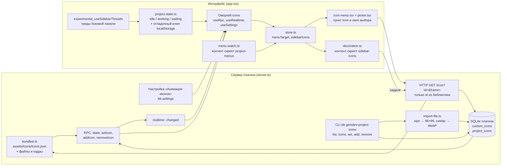

# Архитектура

Плагин bb из двух частей: сервер (`server.ts`, работает внутри bb-сервера) и
интерфейс (`app.tsx`, собирается в `dist/app.js` и грузится в окно bb).

## Части

- **Хранилище.** SQLite плагина (`bb.storage.database()`): `custom_icons`
  (свои картинки: id `custom-…`, название, MIME, байты, хеш) и `project_icons`
  (проект → иконка, `assigned_at` — момент назначения, 0 у старых). Вшитые иконки и кадры не в базе: читаются из
  `assets/icons` при загрузке плагина.
- **HTTP.** `GET /api/v1/plugins/genidev-project-icons/http/icon?id=<id>[&frame=left|right|puzzled]&v=<хеш>`,
  `auth: local`. Отдаёт только id из библиотеки и только известные имена кадров
  (чужое имя кадра — 400, нет такой иконки или кадра — 404). Тип берётся из
  первых байтов файла, `nosniff`, кеш на год (хеш в адресе меняется вместе с файлом).
- **RPC.** `state` (проекты, библиотека с адресами кадров), `setIcon`,
  `addIcon` (base64 картинки, проверка по байтам), `removeIcon`. После изменения
  сервер шлёт realtime `changed`, все окна перечитывают `state`.
- **Вставка в меню.** У bb нет слота для пунктов меню проекта. `menu-watch.ts`
  находит меню (Radix-меню или нижний лист на телефоне) и держит в нём элемент,
  оверлей рисует туда пункт «Icon» через портал.
- **Пометка строк проекта.** `decoration.ts` ставит ``
  перед названием каждого проекта с иконкой. Внутри — стопка `` кадров и
  атрибут `data-pi-anim`; движение задаёт только CSS. Наблюдатель DOM
  (`scoped-observer.ts`) не смотрит в ленту чата.

## Откуда берётся состояние проекта

Из `experimental_useSidebarThreads()` — того же живого списка тредов, что
рисует боковая панель bb. Он обновляется по realtime-подпискам самого bb,
плагин не делает своих запросов и не опрашивает сервер. Правило в
`project-state.ts`:

- «ждёт владельца» — у треда `hasPendingInteraction` (агент ждёт разрешения или
  ответа на вопрос) или `indicator === "waiting-for-input"`;
- «работает» — `status` равен `starting`, `active` или `stopping`;
- «ждёт» важнее «работает»; скрытые (`isHidden`) и архивные треды не считаются.

На сервере те же поля есть у `bb.sdk.threads` (`status`, `hasPendingInteraction`),
но поля `indicator` там нет, а интерфейсу и так нужен живой список, поэтому
состояние считается только на клиенте.

## Технологии

TypeScript, React 19 из `@get-bb/plugin-sdk/app`, `@get-bb/plugin-sdk` 0.6.157,
zod 4, SQLite через хранилище плагина. Внешние программы для `add`: `/usr/bin/sips`
(macOS) и `cwebp` (Homebrew, необязательно). Docker-образов нет.

## Выпуск

- Репозиторий: локальная папка `~/.bb/plugins_bb/bb-plugin-genidev-project-icons`,
  ветка `main`. CI нет.
- Сборка и проверка: `npx tsc --noEmit`, `npm test`, `bb plugin build`.
- Обновление в bb: плагин установлен из этой папки (`source: path:`), новая
  сборка подхватывается командой `bb plugin reload genidev-project-icons`.
