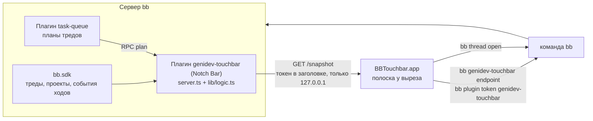

# Устройство

Две части на одном Mac: плагин внутри сервера bb и отдельное приложение macOS.



## Плагин (`server.ts`, `lib/`)

- `lib/contract.ts` — формат сводки. По нему же написан декодер в `native/Sources/Model.swift`. Менять только в обоих местах сразу.
- `lib/icons.ts` — подбор иконок тредов и исполнителей, хеш, закрепления. Тесты в `tests/icons.test.mjs`.
- `lib/logic.ts` — расчёты без обращения к bb: время работы по событиям хода, состояние карточки, порядок, удержание готовых планов. Покрыто тестами в `tests/`.
- `server.ts` — сбор данных и выдача:
  - кандидаты: до 40 свежих видимых тредов;
  - план каждого берётся у плагина `task-queue` вызовом RPC `plan`;
  - время считается по событиям `turn/started` и `turn/completed`, читаются только новые события после сохранённой позиции;
  - тред, который не работает и не менялся, переспрашивается раз в 30 секунд; готовая сводка живёт в памяти 1 секунду;
  - по каждой задаче считается работа агента за срок задачи, по всем тредам — итог (`summary`): проекты и треды в работе, задачи в них, факт и план;
  - выдача: команда `bb genidev-touchbar snapshot`, адрес `GET /api/v1/plugins/genidev-touchbar/http/snapshot` с проверкой токена.
- `lib/app.ts` — приложение на этом Mac: путь к `native/install.sh` и `native/uninstall.sh` в текущей копии плагина, запуск скрипта через `/bin/bash` с путём аргументом и таймаутом 10 минут, состояние (файл приложения и его версия, LaunchAgent, процесс, время последнего чтения сводки). Команды `bb genidev-touchbar install-app [--run]`, `uninstall-app [--run]`, `status`. Тесты в `tests/app.test.mjs`.
- Иконки: раз в 30 секунд сервер спрашивает у плагина `genidev-project-icons` RPC `state` (библиотека и выбранные владельцем иконки проектов). Иконка проекта треда идёт в карточку как `chosen: true`; иначе тред получает свою из библиотеки (хеш id треда, без повторов среди соседей) и она закрепляется в `bb.storage.kv` (`pin:<id треда>`, забываются через 30 дней без треда в сводке). Иконка исполнителя тикета считается по хешу его имени и не хранится. Подбор — чистые функции в `lib/icons.ts`. Картинки отдаёт плагин иконок, в сводке только `iconUrl`. Плагин иконок выключен или пуст — все иконки `null`.
- Базы данных нет (кроме закреплений иконок в `bb.storage.kv`). Всё состояние плагина в памяти и после перезагрузки плагина собирается заново.

## Приложение (`native/`)

- `main.swift` — разбор флагов, запуск.
- `App.swift` — окно поверх строки меню, геометрия выреза, наведение, меню, общие часы анимаций.
- `Views.swift` — палитра, геометрия, фигура полоски, кольцо.
- `Wings.swift` — ширина крыльев и граница по значкам строки меню.
- `Robot.swift` — лицо робота, его настроения, спокойный режим полоски, строка робота в панели.
- `Panel.swift` — раскрытая панель: шапка, фильтры, строки тредов, задачи по нажатию, меню.
- `Track.swift` — значок проекта, дорожка задач, легенда.
- `Events.swift` — события по разнице соседних сводок, очередь сообщений у выреза, звук, настройки.
- `BBClient.swift` — поиск `bb`, получение адреса и токена, опрос раз в 2 секунды, повторное получение адреса после трёх неудач. Сначала спрашивает плагин `genidev-touchbar`; если bb отвечает, что такого нет, один раз за поиск пробует прежний `touchbar` и пишет об этом строку в лог (переход с версии 0.1).
- `Model.swift` — разбор сводки (новые поля необязательные), формат времени, формы слов.
- `Render.swift` — отрисовка в PNG и самопроверка для проверки без экрана.
- `Icons.swift` — картинки иконок тредов и исполнителей: запрос к плагину иконок только на 127.0.0.1, проверка ответа, кеш в памяти и в `~/Library/Caches/bb-touchbar/icons/` на неделю.
- `Assets/mascot/` — только `README.md` с именами кадров. Картинки в плагин не кладутся: личный талисман лежит у пользователя в `~/Library/Application Support/bb-touchbar/mascot/`. Порядок поиска: `--mascot-dir`, папка пользователя, ресурсы приложения, иначе рисуется робот.
- `Lang.swift` — `--lang en` для отрисовки: английские подписи полоски и панели и английские демо-данные (снимки для каталога). Живое приложение по-русски.
- `Log.swift` — лог `~/Library/Logs/bb-touchbar.log`.

Настройки приложения (сообщения, звук) лежат в `UserDefaults` с идентификатором `app.gguzhov.bb-touchbar`.

Файлы на машине после установки:

| Что | Где |
|---|---|
| Приложение | `~/Applications/BBTouchbar.app` |
| Запуск при входе | `~/Library/LaunchAgents/app.gguzhov.bb-touchbar.plist` |
| Путь к `bb` | `~/Library/Application Support/bb-touchbar/config.json`, права 600 |
| Свой талисман (по желанию) | `~/Library/Application Support/bb-touchbar/mascot/*.png`; `uninstall.sh` его не трогает, удаляет только с `--purge` |
| Сборка из копии только для чтения | временная папка `$TMPDIR/bb-touchbar-build.*`, удаляется после установки |
| Лог | `~/Library/Logs/bb-touchbar.log` |

## Безопасность

- Сводку отдаёт только адрес с проверкой токена плагина. Токен приложение получает командой `bb plugin token genidev-touchbar`, держит в памяти, на диск и в лог не пишет и отправляет только на 127.0.0.1.
- В сводке нет текста сообщений, запросов и путей к файлам: только названия проекта, треда, плана и текущей задачи, числа и время.
- Приложение не использует частные API macOS и не ходит в сеть дальше своего компьютера.

## Технологии

TypeScript, `@get-bb/plugin-sdk` 0.6, zod. Swift 6, AppKit, SwiftUI. Сторонних зависимостей у приложения нет. Docker не используется.

## Выпуск

Ветка одна, `main`, репозиторий `gguzhov/bb-touchbar` (приватный). CI нет. Идентификатор плагина с версии 0.2.0 — `genidev-touchbar` (в каталоге bb `touchbar` занят чужим плагином), папка исходников прежняя: `~/.bb/plugins_bb/bb-plugin-touchbar`. Выпуск на этом Mac:

```
npm run typecheck && npm test && npm run build
bb plugin reload genidev-touchbar   # плагин
native/install.sh                   # приложение: пересборка и перезапуск
```

Откат: `git checkout <hash>` и те же две команды. Полное удаление: `native/uninstall.sh` и `bb plugin remove genidev-touchbar`.

Публикация в каталог bb идёт снимком в открытый репозиторий `gguzhov/bb-plugins` (`plugins/genidev-touchbar`, тег `genidev-touchbar/v<версия>`) по `RELEASING.md` той копии. Скрипт выпуска ищет исходники в папке `bb-plugin-genidev-touchbar`, поэтому ему передаётся `--source-dir` с копией под этим именем. Пользователь каталога ставит плагин `bb plugin install genidev-touchbar`, затем приложение: `bb genidev-touchbar install-app --run`.
